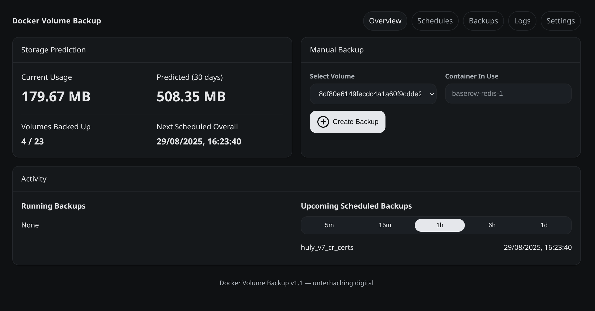

# Dockbare

Dockbare backs up my Docker volumes, encrypts them, pushes them to a couple of FTP/SFTP servers
and gets everything back when a box dies. I built it for my own servers; it's free for anyone to
use, no account, no license key, no telemetry. It is a personal project, not a product: no support
promises, no roadmap, use it at your own risk. Issues and PRs are welcome anyway.



## What it does

- **Backups** of any Docker volume as `tar.gz` (containers using the volume are stopped for a consistent
  snapshot and started again), restore with one click, integrity check, upload of existing archives.
- **Encryption** with one system-wide key from `.env`. Archives are encrypted before they leave the host,
  so the FTP server only ever sees ciphertext. Old plain backups still restore, and
  `python -m dockbare decrypt` works without the app if you ever need it.
- **Any number of remotes** (FTP, FTPS, SFTP), each schedule and manual backup picks its targets, upload
  status per remote, a sync job that catches up after outages. Remotes can be configured in the UI or in `.env`.
- **Several instances, one server**: every installation has an instance name and stores under
  `<base>/<instance>/<volume>/`, so three Dockbare boxes can share the same FTP without stepping on each other.
- **Schedules & retention**: "daily at 03:00 on weekdays" or "every 12 h", delete older than N days and/or
  keep at most N, optionally also on the remotes. The newest backup is never deleted.
- **Recovery mode**: fresh server, same `.env`, scan a remote → see every instance, volume and backup that
  is up there → pick → Dockbare downloads, verifies, creates missing volumes and restores.
- **Peers**: instances watch each other. If a peer stops answering, you get an urgent notification;
  when it's back, another one. Works even though they back up completely different things.
- **Uptime**: every container's state, health check, exit code and OOM flag straight from the Docker
  socket, with incidents, per-container rules (notify, auto-restart with a budget, require healthy,
  grace period) and an optional public status page at `/` (the app itself lives under `/admin`) that also shows your peers.
- **Config snapshot**: everything that isn't in `.env` (schedules, remotes, channels, peers, monitors,
  report/uptime settings) is encrypted with the backup key and pushed to every remote whenever it changes.
  Recovery imports it with one click.
- **Reports** (daily / weekly / monthly) by email, ntfy or webhook: what was backed up, what failed,
  what got pruned, how much space is used, which schedules are overdue.
- **Login** with password (plus optional TOTP), lockout after failed attempts, sessions you can revoke,
  no third-party assets at all. Light and dark UI, works on a phone.

## Running it

```bash
git clone <this repo> dockbare && cd dockbare
cp .env.example .env
docker run --rm -v "$PWD":/app -w /app python:3.12-slim sh -c "pip -q install -r requirements.txt && python -m dockbare gen-secret"
nano .env               # admin password, secret key, encryption key (paste the generated values)
docker compose up -d --build
```

Open http://127.0.0.1:5000/admin and sign in with the user/password from `.env`. The root URL `/` is the
public status page (once enabled under Uptime → Settings); until then it shows a short note.

The compose file binds to localhost on purpose. Dockbare has the Docker socket, which is root on the
host, so put a TLS reverse proxy (Traefik, Caddy, nginx) in front for remote access and set
`DOCKBARE_BEHIND_PROXY=true`. Turn on TOTP if the UI is reachable from the internet.
And **keep `DOCKBARE_ENCRYPTION_KEY` somewhere safe**; without it the encrypted backups are just noise.

### Portainer

Create a git stack pointing at this repository and put the settings from `.env.example` into the
stack's *Environment variables* (Portainer writes them to `stack.env`, which both compose files read).
Set `PROXY_NETWORK` to your reverse-proxy network and `DOCKBARE_PORT` if 5000 is taken.
[docker-compose.yml](docker-compose.yml) publishes the port for a reverse proxy such as Nginx Proxy
Manager; [docker-compose.portainer.yml](docker-compose.portainer.yml) carries Traefik labels instead.

Both keep the database and the archives in the Docker volumes `dockbare_data` and `dockbare_backups`,
which survive every stack update. Never point `DOCKBARE_DATA_PATH` at a relative `./data` in a git
stack: Portainer checks each update out into a new directory and the database would start empty
(remotes, schedules, 2FA gone; the dashboard warns when that happens). Absolute host paths are fine.
Portainer builds the image from the repository on every stack update (`pull_policy: build`); leave
Portainer's "re-pull image" option off, there is nothing to pull. `/api/health` shows the `build`
fingerprint so you can see which version is actually running.

## `.env`

Everything that matters for a reinstall lives in `.env`, so disaster recovery is: restore `.env`,
`docker compose up -d`, open Recovery, import the configuration snapshot, restore the volumes.

| Variable | Description |
|---|---|
| `DOCKBARE_ADMIN_USER` / `DOCKBARE_ADMIN_PASSWORD` | Login. Required; everything is blocked without it. `DOCKBARE_ADMIN_PASSWORD_HASH` works too (`python -m dockbare hash-password`). |
| `DOCKBARE_TOTP_SECRET` | Optional second factor (`python -m dockbare totp-setup`). |
| `DOCKBARE_SECRET_KEY` | Signs sessions, encrypts stored passwords. Generated into `/data` if missing, but set it. |
| `DOCKBARE_ENCRYPTION_KEY` | The backup encryption key. |
| `DOCKBARE_INSTANCE_NAME` | Name of this installation, used as folder on shared remotes and shown to peers. |
| `DOCKBARE_REMOTE_1_HOST`, `_TYPE`, `_PORT`, `_USER`, `_PASSWORD`, `_PATH`, `_TLS`, `_PASSIVE`, `_NAT_FIX`, `_VERIFY_TLS`, `_PRIVATE_KEY[_FILE]`, `_KEY_PASSPHRASE`, `_HOST_KEY`, `_INSTANCE_DIR`, `_ENABLED` | Remotes 1–9. Shown as locked in the UI. |
| `DOCKBARE_SMTP_*`, `DOCKBARE_NTFY_*`, `DOCKBARE_WEBHOOK_*` | Notification channels (also configurable in the UI; `.env` wins). |
| `DOCKBARE_PEER_TOKEN` | Token other instances use to read this one's status. Generated if missing. |
| `DOCKBARE_PEER_1_URL`, `_TOKEN`, `_NAME`, `_DISPLAY_NAME`, `_INTERVAL`, `_THRESHOLD`, `_ALERT_ON_PROBLEMS`, `_VERIFY_TLS`, `_ENABLED` | Peers 1–9 to watch. Shown as locked in the UI. `_DISPLAY_NAME` is the heading of that peer's group on the public status page. |
| `DOCKBARE_BEHIND_PROXY`, `DOCKBARE_SECURE_COOKIES` | `true` behind a reverse proxy; cookie flag `auto`/`true`/`false`. |
| `DOCKBARE_SESSION_*`, `DOCKBARE_LOGIN_*` | Session lifetime and login throttling. |
| `DOCKBARE_HELPER_IMAGE` | Image for the helper containers (default: the Dockbare image itself). |
| `DOCKBARE_PORT`, `DOCKBARE_LISTEN` | Port and bind address inside the container (5000 / 0.0.0.0). `DOCKBARE_HOST` is the public host name used only by the compose/Traefik labels. |
| `TZ` | Time zone for schedules and reports. |

See [.env.example](.env.example) for all of them with comments; only the admin password is required,
everything else has a default or is optional. What is *not* in `.env` (schedules, retention, channels
set up in the UI, peers, monitors, report/uptime settings) lives in `/data/dockbare.db`, with passwords
encrypted by the secret key, and is what the configuration snapshot contains. Anything that comes from
`.env` is left out of the snapshot on purpose, so the two never overlap: `.env` + snapshot = full setup.

## How a backup works

A helper container (never started) mounts the volume read-only; the Docker Engine archive API
streams a tar through Dockbare, which gzips, encrypts and hashes it on the fly and writes
`/backups/<volume>/<UTC timestamp>.tar.gz[.enc]` plus a `.meta.json` sidecar (size, SHA-256,
containers, compose project, instance, key fingerprint). Then the containers are started again, the
file and sidecar go to the selected remotes and retention runs. Restore is the same pipeline backwards
into a helper container with the volume mounted read-write. There is no host path mapping any more
(`BACKUP_HOST_DIR` is gone) and no `docker` CLI inside the image.

### Recovery on a new host

1. Install with the same `.env` (same encryption key, remotes in `.env` if you like).
2. Recovery → remote → *Scan*. If a configuration snapshot is up there, *Import* it: schedules,
   remotes, channels, peers and monitors are back.
3. `docker compose up -d` your stacks so the volumes exist with their names, or let Dockbare create them.
4. Pick instance/volumes → *Restore selected*.

Only the volume name has to match. The sidecar tells you which host and containers a backup came from
and whether your key fits before anything is downloaded.

### Upgrading from the old "Docker Volume Backup" (v2)

Mount the same `./backups` directory. On first start the old `backup_config.json` (schedules, FTP server,
ntfy topic) and the FTP sync state are imported and renamed to `*.migrated`. Existing archives keep
working; the migrated FTP remote keeps the flat `<base>/<volume>` layout so nothing moves on the server.
New: a `./data` volume and the `.env` with an admin password.

### Uptime and the public status page

Dockbare polls the Docker socket (and listens to its event stream) and classifies every container:
running, unhealthy, exited with an error, OOM-killed, stuck restarting, or gone. A clean stop
(exit code 0) is not an outage unless you say so. Per container you choose whether to notify,
whether to restart it automatically (with a budget, e.g. 3 per 30 min, after which Dockbare gives up
and tells you), and whether it appears on the public page. Enable the page under Uptime → Settings;
it is served at `/` (and `/uptime`), needs no login, shows only the containers you marked public (with
display names) with a 90-day availability graph per service, plus your peers and *their* public services, so
pinned instances give one global view. A peer's group is headed by the "Name on the status page" you give it
under Peers → Edit, else by the name the peer reports for itself (its own "Name of this site" setting or its
instance name), else by the peer's name. You can also declare incidents yourself (investigating →
identified → monitoring → resolved, minor or major) and schedule maintenance windows; both appear on
the page, and during a maintenance window the affected containers neither alert nor count as downtime.

Beyond containers: **external checks** (Uptime → External checks) ping any `https://…` URL (up while it answers
below HTTP 400) or `tcp://host:port` (up while the port accepts connections), e.g. a domain, an API or a managed
database, with their own interval, timeout and grace period; they notify like containers and can be shown on the
public page. **Services** group several containers and/or checks into one entry on the page (say `Shop` = app +
database + payment API); either any member being down marks the service as down, or it shows a partial outage
until all members are down, and each member can be renamed for the page. Containers, checks and services can carry
an icon (image URL or emoji), a website link and a one-line description for the page. Peers' services get their own
section per site, or one flat list with a small site tag when "Show peers' services in the same list" is on; while
the page shows peers, their reports are refreshed every minute independently of the alerting interval, so a change
on a peer appears within about two minutes. An unreachable peer counts as a partial outage and is named on the page. With the page enabled, `/badge.svg` is a live **status badge** in the look of the page ("All systems
operational", "Partial outage", "Major outage", "Maintenance"; `?theme=light`, `?label=…`, or `?style=flat` for the
classic shields look) to embed anywhere, and `/badge.json` serves the same in the shields.io endpoint format; Uptime → Settings has copy-ready HTML and
Markdown snippets that link the badge to the page.

## Command line

```bash
python -m dockbare serve            # run the server (default)
python -m dockbare check            # validate .env and Docker access
python -m dockbare gen-secret       # print random DOCKBARE_SECRET_KEY / DOCKBARE_ENCRYPTION_KEY
python -m dockbare hash-password    # print DOCKBARE_ADMIN_PASSWORD_HASH
python -m dockbare totp-setup       # print a TOTP secret and otpauth:// URI
python -m dockbare decrypt backup.tar.gz.enc   # decrypt without the app (asks for the key)
```

Inside the container: `docker exec -it dockbare python -m dockbare check`.

## Hacking on it
 
```bash
python -m venv .venv && . .venv/bin/activate
pip install -r requirements-dev.txt
cp .env.example .env.dev            # point DOCKBARE_DATA_DIR / DOCKBARE_BACKUP_DIR at local folders
DOCKBARE_ENV_FILE=.env.dev python -m dockbare serve
pytest
```

Architecture, the encryption format and the security model are in [docs/DESIGN.md](docs/DESIGN.md).
